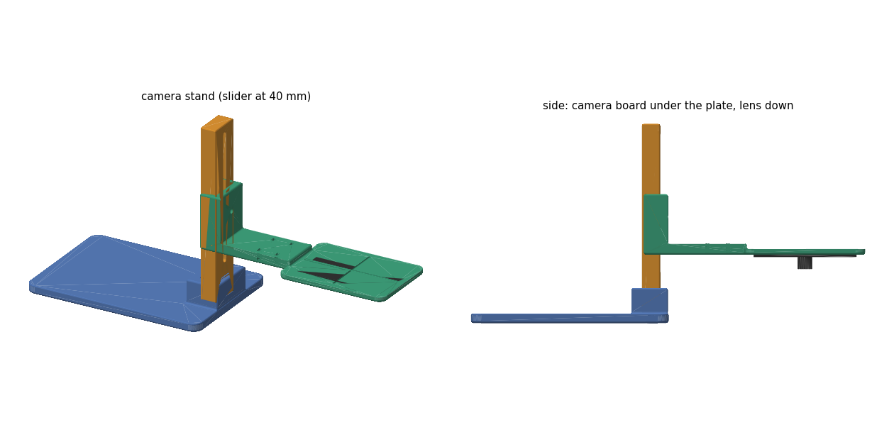

# Camera test stand

Lets you write and test the vision code before the plotter exists. The camera looks straight down at the field
from the wrist camera heights (lens about 11..80 mm; on the plotter 30..65 mm).

## Print (PETG, STEP in `out/`)
| Part | File | Print |
|---|---|---|
| base | `camera_stand_base.step` | as exported (flat side down) |
| post | `camera_stand_post.step` | lying flat, slot vertical |
| slider + arm + camera plate | `camera_stand_slider.step` | as exported (arm down) |

Bought: M3x20 bolt + M3 nut + 2 washers (height clamp), 2x M3x12 (post to base, from below; they cut their own
thread in the 2.5 mm holes, try on a scrap first).

## Camera board
DF-1901A USB webcam board (1080p, no datasheet found), taken out of its case. Screw the board UNDER the plate, lens pointing down.
The plate has no holes: drill them to match the board. The two grooves on top cross at the plate centre.
The board and lens in the model are a placeholder (VERIFY: measure the board, then change `CAM_PCB`, `CAM_LENS`).

**Risk: focus.** The webcam is fixed focus, made for faces about 0.5 m away. At 30..65 mm it will probably be blurry.
Many such lenses screw into their holder (often with a drop of glue): turn it a little while watching the focus
number in `cam_stand.py`. If it cannot focus that close, the camera on the plotter has to sit higher, or needs a
close-focus lens. This stand is how we find out.

## Program
    laptop\.venv\Scripts\python laptop\cam_stand.py 1        (1 = USB webcam, 0 = laptop camera)
Shows the focus score, each checker's colour, px per mm and the lens height worked out from its size (26 mm),
QR text and ArUco marks. Keys: S snapshot, P print, B reset best focus, C checkers on/off, +/- FOV.

## Rebuild
    cd camera_stand
    ..\fcpy.bat camera_stand.py      -> out/*.step, out/dfm.json (DFM: walls, overhang, bridges, sharp corners)
    ..\fcpy.bat render.py            -> out/camera_stand.png
