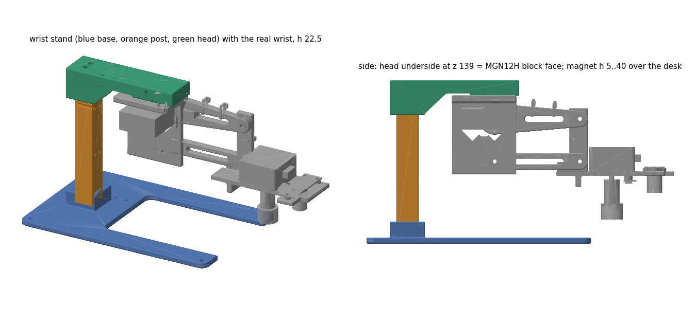

# Wrist test stand

Holds the **real wrist module** at its real height over the desk, so the lift servo, the electromagnet, the wrist
stepper, the distance sensor and the camera can be tested before the rails and the frame exist.
The head copies the underside of the MGN12H X block (same 3 screw holes, face 139 mm above the desk), so the
wrist carriage bolts on exactly as on the plotter, and the magnet face moves 5..40 mm above the desk just like
over the field. The desk between the U legs is the "field": put checkers there.

## Print (PETG, STEP in `out/`)
| Part | File | Print | Mass |
|---|---|---|---|
| base (U foot + post socket) | `wrist_stand_base.step` | as exported, flat side down (211 x 141 mm) | 74 g |
| post 20 x 20 x 141 | `wrist_stand_post.step` | as exported, lying on its side | 42 g |
| head (block copy + arm + socket) | `wrist_stand_head.step` | as exported, top face down, socket open upward | 53 g |

DFM clean (walls >= 2.8 mm, no overhangs, bridges <= 6 mm, no sharp inside corners).

Bought: 3x Ruthex M3 inserts (in the head's underside, like the block's threads), 3x M3x8 (carriage to head),
4x M3x12 (post into base and head: they cut their own thread in the 2.5 mm holes, try on a scrap first).
Optional: 4 wood screws (3.5 mm holes in the foot corners) or a clamp, if it rocks.

## Assemble
1. Post into the base socket, 2x M3x12 from below. Head over the post top, 2x M3x12 from above.
2. Build the wrist as in the main README (assembly order), but **without** the X belt riser, the belt clamp and the
   chain post: the head is wider than the block (34 mm, for 2.4 mm walls round the inserts) and covers the riser's
   place. Those three parts are tested on the plotter.
3. Screw the wrist carriage to the head from below with the 3 block screws (same holes as on the X block).
4. Wrist harness up the arm and post: zip-tie slots on the head arm, the post and the foot.

## What it checks (model, 24 Nov)
- No part of the wrist touches the stand at h 5 / 10 / 22.5 / 30 / 40 mm with the wrist at 0 / 90 / 180 / 270 deg
  (only the carriage sits on the head face, as designed). Magnet face h 5.0..40.0 mm above the desk.
- Tipping: wrist about 317 g (model, bought parts by datasheet), stand about 180 g; centre of mass at x 27, y 8,
  62 mm inside the foot edges. The servo's jerk is small; screw or clamp it down if it walks.

## Tests to do on it (firmware v5 commands, `firmware/README.md`)
- **Lift:** `servo 1500` then other pulses; measure the magnet face height with a ruler at each pulse and send the
  table to Claude (gives `servomin` / `servomax` and the pulse for h 5 / 22.5 / 40). Watch the arms never touch.
- **Magnet:** a checker on the desk, lower to h 5, `mag on`, lift to 40, wait, `mag off`. Try `set maghold` 30 / 40 / 60:
  the lowest hold that never drops it. Does the checker fall off at `mag off` (release, `vault` "Magnet release")?
- **Wrist:** `zero w` at the mark, `wrist 90`, `wrist 180`, `wrist -90`: the magnet leads must not wind up.
- **Stack:** pick and stack 5 checkers by hand-typed commands (h steps of 5 mm per checker).
- **Camera / distance sensor:** the shelf camera and the TOF400C see the desk at the real heights.

## Not tested / risks
- Only modelled: nothing printed yet. The wrist parts themselves are still waiting on coupons D1, F1, E2 and caliper
  checks of the MG996R and the 17HS4023S (`docs/print_log.md`, step 3).
- The 2.5 mm self-threading holes are the camera stand's guess (VERIFY on a scrap).
- Without the riser and clamp, the X belt grip is not tested here.

## Rebuild
    cd wrist_stand
    ..\fcpy.bat wrist_stand.py      -> out/*.step, out/check.json (DFM, clash over the lift and wrist range, tipping), ~5 min
    ..\fcpy.bat render.py           -> out/wrist_stand.png
